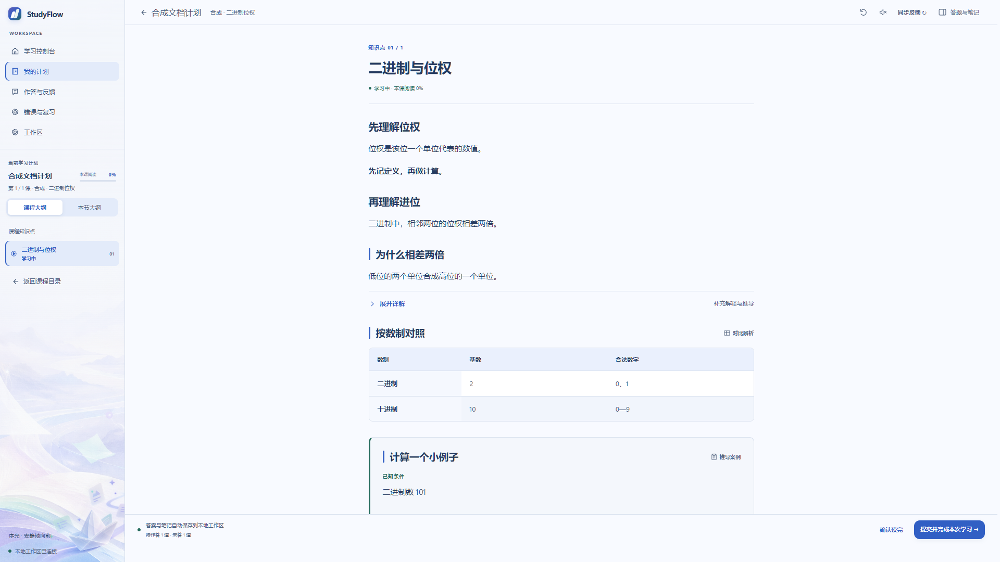
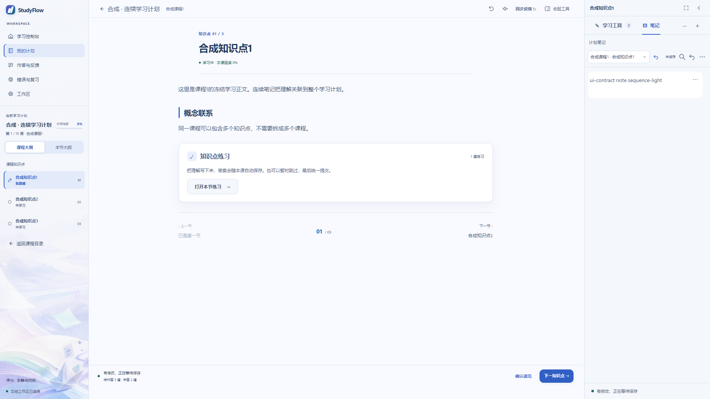
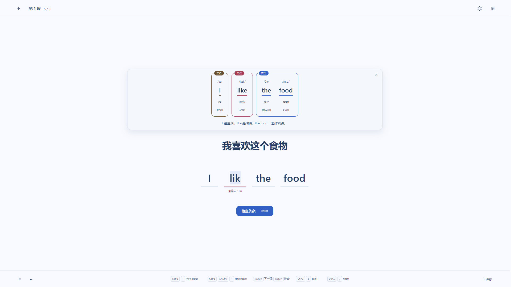
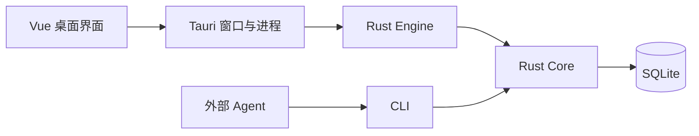

# StudyFlow

把课程阅读、练习作答、连续笔记和英语训练放在同一个本地学习工作台里；外部 Agent 通过 CLI 编写课程与批改反馈，桌面端负责学习和记录。

**个人项目 · Vue 3 + Tauri + Rust · 源码版本 1.8.29**

项目使用 AI 编码工具开发与迭代。桌面端、CLI 与 Engine 共用 Rust Core 和本地 SQLite 工作区。

[下载 Windows 安装包](https://github.com/wssuifeng/studyflow/releases/tag/v1.8.29) · [源码运行](#源码运行) · [版本记录](docs/70_部署运行/源码与安装包对应表.md) · [Agent 接入](#外部-agent-怎样接入) · [Rust 迁移验证](docs/40_开发实施/2026-11-21-全Rust后端替换实施计划.md#8-换模型执行与续接)

## 从阅读到反馈

### 课程阅读：连续正文与按需展开

在课程内按知识点阅读，必要内容常显，补充推导可展开；阅读进度和当前学习轮次分开保存。



### 练习与笔记：保留学习现场

阅读时打开学习工具，记录计划级笔记、检索与引用出处；作答可以自动保存，整课提交后再进入反馈、修正与复测。



### 英语训练：定位错误与理解句子

词句输入、错误定位、句子解析和无提示复测在同一工作流中；一般练习与英语训练的错误证据分开管理。



截图采集于 2026-11-10，使用当前 Vue 构建、真实 Core 与隔离合成数据；来源见 [图片索引](docs/assets/showcase/README.md)。

## 一次学习怎样完成

1. 导入课程包，或让外部 Agent 按实际 CLI 能力编写课程。
2. 打开学习轮次，阅读课程、做练习、记笔记。
3. 提交整课作答，由 Agent 写入结构化反馈，或由英语训练规则检查词句。
4. 对需要修正的答案补充作答，按反馈完成独立复测。
5. 保留原作答、反馈和复测的关联，继续下一门课程。

课程被创建、文件校验通过和学习者真正掌握是不同结果；软件不会用生成内容替代学习证据。

## 结构与三个实现重点




外部 Agent 负责制课与批改。语音提供方在桌面设置中配置，作者可通过 CLI 生成并采用课程音频，学习时从工作区读取音频。

| 重点 | 实现 | 入口 |
|---|---|---|
| 本地数据与写入可靠性 | Core 维护事务、版本检查和幂等回执；保存失败、响应丢失、重试与退出有独立回归 | [持久化层](crates/studyflow-core/src/infrastructure/sqlite/)、[写入可靠性测试](crates/studyflow-core/tests/write_contract.rs) |
| 冻结学习证据 | 课程修订、学习轮次、作答、反馈和复测保持来源关联，旧记录不随新课程直接覆盖 | [数据模型与持久化设计](docs/30_系统设计/数据模型与持久化设计.md) |
| 外部 Agent 接入 | CLI/Engine 返回当前能力与路径；接入说明核对数据根、Skill 和独立协作区，避免凭聊天记忆切换工作区 | [接入实现](crates/studyflow-core/src/infrastructure/installation.rs)、[仓库 Skill](skills/studyflow-agent/SKILL.md) |

主要组件：Vue 3 / TypeScript / Vite、Tauri / Rust、共享 Rust Core / CLI / Engine、SQLite。源码、安装目录、学习数据与 Agent 协作区分别管理。

## 源码运行

需要 Node.js 22、Rust 及 Windows Tauri 的 C++ Build Tools 和 WebView2。源码构建与隔离测试命令见 [构建与开发](docs/40_开发实施/构建与开发.md)。

```powershell
npm --prefix apps/desktop ci
npm --prefix apps/desktop run tauri -- dev
```

调试数据使用显式指定的新工作区。可以先运行 `build-engine.ps1 -Profile debug -BuildOnly`，再通过当前构建的 `studyflow.exe init` 创建演示课程。

## 外部 Agent 怎样接入

1. 从桌面「设置 → Agent 接入」复制当前接入说明。
2. 阅读 [studyflow-agent Skill](skills/studyflow-agent/SKILL.md)，使用说明中的原生 CLI，执行 `version`、`capabilities` 和 `doctor`。各命令支持 `--format json`。
3. 读取 `call --method system.schema --format json` 的当前契约，按能力制作课包、生成并采用音频、发布课程或读取批改队列。

仓库 Skill 2.10.0。生成、内容审核和真实 UI 呈现分别验证。工程验收、安装和公共 Skill 状态见 [版本表](docs/70_部署运行/源码与安装包对应表.md)。

## 继续阅读

- [源码与安装包对应表](docs/70_部署运行/源码与安装包对应表.md)
- [系统架构](docs/30_系统设计/系统架构设计.md) / [模块化结构](docs/30_系统设计/模块化结构重构设计.md)
- [接口与 CLI 契约](docs/30_系统设计/接口与CLI契约.md) / [外部 Agent 入口设计](docs/30_系统设计/外部Agent会话启动指令设计-v1.md)
- [工程总控](docs/00_总控.md) / [开发与提交约定](docs/90_全局/开发与提交约定.md)
- [历史首页](docs/archive/repository-showcase-20261110/INDEX.md)

许可证沿用仓库现状；本轮不新增许可证。

## 更新记录

### 1.8.29（2026-11-22）

- 计划、批改和设置适配窄窗口。目录、工具侧栏和弹窗使用短过渡，并遵循系统的减少动效偏好。
- 英语专注训练的听力字幕区固定高度，阅读支持单双栏，写作题干和编辑区左对齐。
- [Windows x64 MSI 和完整性信息](https://github.com/wssuifeng/studyflow/releases/tag/v1.8.29)

### 1.8.28（2026-11-21，Rust MSI 候选）

- 桌面 Engine 和原生 CLI 共用 Rust Core 与 SQLite。已完成 MSI 载荷核验、原生 WebView2 联调及旧合成工作区读回。
- Windows VM 首装、覆盖及新增学习数据后的撤回按 [W6.3–W6.4](docs/40_开发实施/2026-11-21-全Rust后端替换实施计划.md#81-w63-隔离安装续接) 验证。

### 1.8.27（2026-11-21，本地构建）

- 听力播放器新增「当前句」开关。逐句时间轴随课程保存，旧课支持估算字幕。MSI 内置 Skill 2.9.19。

### 1.8.26（2026-11-21，本地构建）

- 「我的计划」成为启动页。计划里的英语课程一次点击进入题目，旧 `/7` 专项课延续原有作答轮次。

### 1.8.25（2026-11-21，本地构建）

- 作文使用独立编辑和反馈组件。`/8` 听力和阅读支持逐空完整匹配单词或短语，忽略大小写。MSI 内置 Skill 2.9.17。

### 1.8.24（2026-11-21，本地构建）

- 听力、阅读、写作与原有词句练习按同一题序进入英语专注训练。支持 `/8` 混合课与独立课，内置 Skill 2.9.16。

### 1.8.23（2026-11-21，本地构建）

- 修复听力和阅读题组的参考答案缺失误报，内置 StudyFlow Agent Skill 2.9.15。

### 1.8.21（2026-11-12）

- 优化了英语课程交互手感，可交互按键：词框支持 `←`/`→`/退格/`Delete` 在边界自由移动焦点而不破坏输入，`Ctrl`+方向键无视光标直接跳词、`Ctrl`+`Home`/`End` 跳首末词框，导航型退格静音；训练与复测共用，中文输入法组合态不受影响。
- 添加了一个新主题：**国风朱红**——纯白底、中国红批注、玄墨正文，衬线标题与回纹纸饰，明亮简洁。安装后即在「设置 → 外观主题」可选，默认主题仍为白紫。
