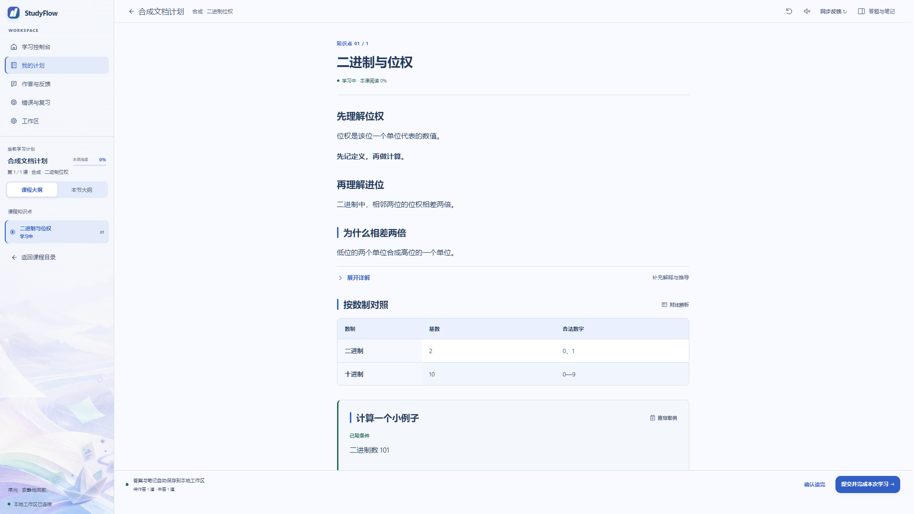
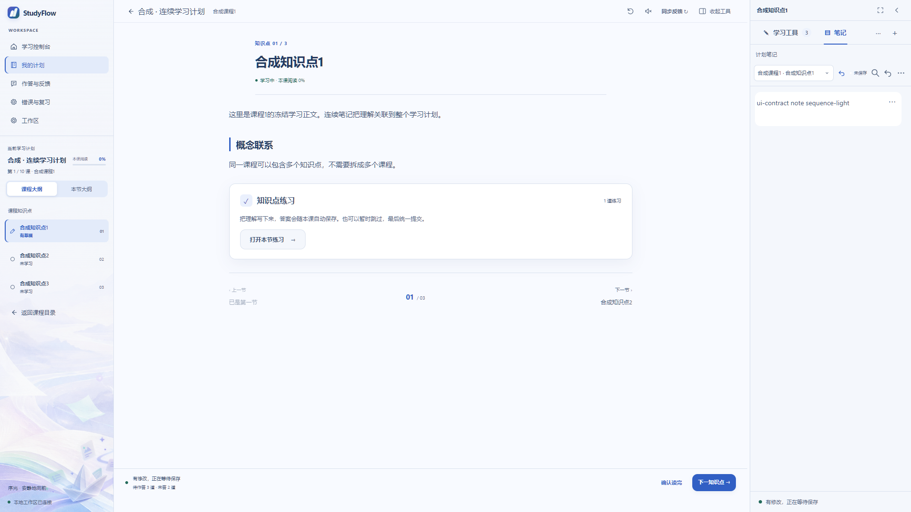
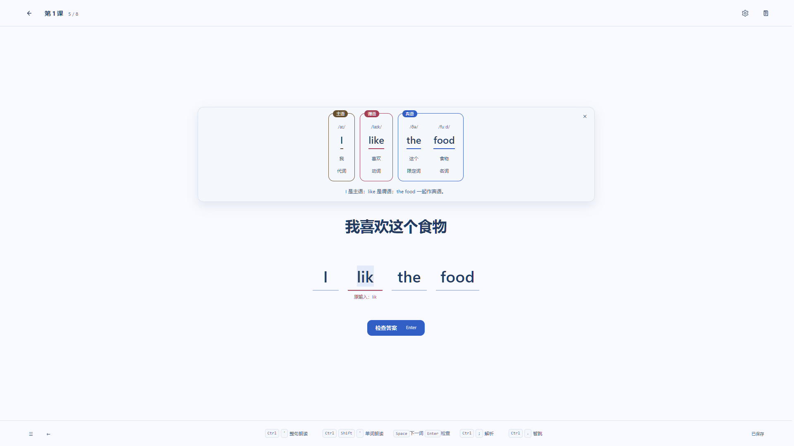
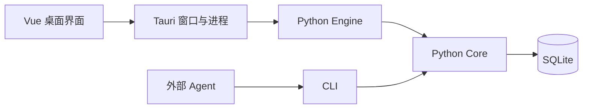

# StudyFlow

把课程阅读、练习作答、连续笔记和英语训练放在同一个本地学习工作台里；外部 Agent 通过 CLI 编写课程与批改反馈，桌面端负责学习和记录。

**个人项目 · Vue 3 + Tauri + Python · 源码版本 1.8.21**

项目使用 AI 编码工具开发与迭代。当前提供源码与工程验证记录；最新安装包见 GitHub Release v1.8.21（未签名 MSI）；安装与长期体验验收另行记录。

[源码运行](#源码运行) · [版本与安装包](docs/70_部署运行/源码与安装包对应表.md) · [Agent 接入](#外部-agent-怎样接入) · [验证记录](docs/40_开发实施/2026-11-10-仓库收口与验证记录.md)

## 从阅读到反馈

### 课程阅读：连续正文与按需展开

在课程内按知识点阅读，必要内容常显，补充推导可展开；阅读进度和当前学习轮次分开保存。



### 练习与笔记：保留学习现场

阅读时打开学习工具，记录计划级笔记、检索与引用出处；作答可以自动保存，整课提交后再进入反馈、修正与复测。



### 英语训练：定位错误与理解句子

词句输入、错误定位、句子解析和无提示复测在同一工作流中；一般练习与英语训练的错误证据分开管理。



截图采集于 2026-11-10，使用当前 Vue 构建、真实 Core 与隔离合成数据；来源见 [图片索引](docs/assets/showcase/README.md)。这些是浏览器运行截图，不是安装包验收结论。

## 一次学习怎样完成

1. 导入课程包，或让外部 Agent 按实际 CLI 能力编写课程。
2. 打开学习轮次，阅读课程、做练习、记笔记。
3. 提交整课作答，由 Agent 写入结构化反馈，或由英语训练规则检查词句。
4. 对需要修正的答案补充作答，按反馈完成独立复测。
5. 保留原作答、反馈和复测的关联，继续下一门课程。

课程被创建、文件校验通过和学习者真正掌握是不同结果；软件不会用生成内容替代学习证据。

## 结构与三个实现重点




AI 在外部 Agent 一侧，桌面端没有内置模型聊天或模型调用服务；模型提供方与授权由使用者选择。

| 重点 | 实现 | 入口 |
|---|---|---|
| 本地数据与写入可靠性 | Core 维护事务、版本检查和幂等回执；保存失败、响应丢失、重试与退出有独立回归 | [持久化层](packages/core/src/studyflow/infrastructure/persistence/)、[写入可靠性测试](packages/core/tests/test_write_reliability.py) |
| 冻结学习证据 | 课程修订、学习轮次、作答、反馈和复测保持来源关联，旧记录不随新课程直接覆盖 | [数据模型与持久化设计](docs/30_系统设计/数据模型与持久化设计.md) |
| 外部 Agent 接入 | CLI/Engine 返回当前能力与路径；接入说明核对数据根、Skill 和独立协作区，避免凭聊天记忆切换工作区 | [接入实现](packages/core/src/studyflow/infrastructure/installation.py)、[仓库 Skill](skills/studyflow-agent/SKILL.md) |

主要组件：Vue 3 / TypeScript / Vite、Tauri / Rust、Python Core / CLI / Engine、SQLite。源码、安装目录、学习数据与 Agent 协作区分别管理。

## 源码运行

需要 Python 3.12+（本轮使用 3.13）、Node.js 22+、Rust，以及 Windows Tauri 的 C++ Build Tools / WebView2 前置条件。完整步骤见 [构建与开发](docs/40_开发实施/构建与开发.md)。

以下为 Windows PowerShell，从仓库根目录运行：


```powershell
git clone https://github.com/wssuifeng/studyflow.git
cd studyflow
py -3 -m venv packages/core/.venv
$python = Join-Path $PWD "packages/core/.venv/Scripts/python.exe"
& $python -m pip install -e "./packages/core[dev]" "pyinstaller>=6.10,<7"
npm --prefix apps/desktop ci
npm --prefix apps/desktop run build
& ./apps/desktop/scripts/build-engine.ps1
```

为了使用独立演示数据，在**同一终端**指定新建目录，再初始化示例并启动桌面开发版：


```powershell
$env:STUDYFLOW_WORKSPACE = Join-Path $env:TEMP ("studyflow-demo-" + [guid]::NewGuid())
& $python -X utf8 -m studyflow init
& $python -X utf8 -m studyflow doctor --format json
npm --prefix apps/desktop run tauri -- dev
```

成功判据：Core 的 doctor 能读取指定演示工作区，桌面端打开相同工作区，课程可阅读、练习可保存、笔记可恢复。不要对已有学习数据重复执行 init，也不要用新版本覆盖真实数据来代替迁移验证。

## 外部 Agent 怎样接入

1. 读取完整的 [studyflow-agent Skill](skills/studyflow-agent/SKILL.md)，不要只复制一段指令。
2. 在工作区页面复制接入说明，让 Agent 核实 CLI、Skill 和数据工作区的实际路径。
3. 先执行 version、capabilities、doctor，再按返回的 schema 操作。源码方式示例：


```powershell
& $python -X utf8 -m studyflow version --format json
& $python -X utf8 -m studyflow capabilities --format json
& $python -X utf8 -m studyflow doctor --format json
```

课程生成、内容审核和真实 UI 呈现分别验证；Agent 不应直接写 SQL、猜测接口或替学习者作答。仓库 Skill 当前为 2.9.13，不表示其他电脑或公共 Skill 目录已经同步更新。

## 本轮检查与限制

2026-11-10 在隔离合成数据上验证：

| 检查 | 结果 |
|---|---|
| Python Core | 508 通过、2 条件跳过 |
| 前端学习 / 主题 / 英语 | 136 / 89 / 56 通过 |
| 主题规则与生产构建 | 通过 |
| Rust 库测试 | 10 通过 |
| 冻结 Windows Engine | 构建通过，48 项冒烟检查通过 |
| 浏览器流程 | 学习、英语、英语轻量训练、注释、整课反馈修正流程与 CLI 冒烟通过 |
| 双主题 UI 契约 | 33 项通过，0 失败，0 页面错误 |

本轮还修正了旧浏览器脚本对工具菜单、英语完成态和接入说明的过期断言。测试运行、命令和未覆盖范围见 [验证记录](docs/40_开发实施/2026-11-10-仓库收口与验证记录.md)。

本轮未发布安装包、未覆盖安装真实应用、未验证用户听音体验或长期学习效果。浏览器/Engine 自动化通过不能替代这些验收。

## 继续阅读

- [源码与安装包对应表](docs/70_部署运行/源码与安装包对应表.md)
- [系统架构](docs/30_系统设计/系统架构设计.md) / [模块化结构](docs/30_系统设计/模块化结构重构设计.md)
- [接口与 CLI 契约](docs/30_系统设计/接口与CLI契约.md) / [外部 Agent 入口设计](docs/30_系统设计/外部Agent会话启动指令设计-v1.md)
- [工程总控](docs/00_总控.md) / [开发与提交约定](docs/90_全局/开发与提交约定.md)
- [历史首页](docs/archive/repository-showcase-20261110/INDEX.md)

许可证沿用仓库现状；本轮不新增许可证。

## 更新记录

### 1.8.21（2026-11-12）

- 优化了英语课程交互手感，可交互按键：词框支持 `←`/`→`/退格/`Delete` 在边界自由移动焦点而不破坏输入，`Ctrl`+方向键无视光标直接跳词、`Ctrl`+`Home`/`End` 跳首末词框，导航型退格静音；训练与复测共用，中文输入法组合态不受影响。
- 添加了一个新主题：**国风朱红**——纯白底、中国红批注、玄墨正文，衬线标题与回纹纸饰，明亮简洁。安装后即在「设置 → 外观主题」可选，默认主题仍为白紫。
