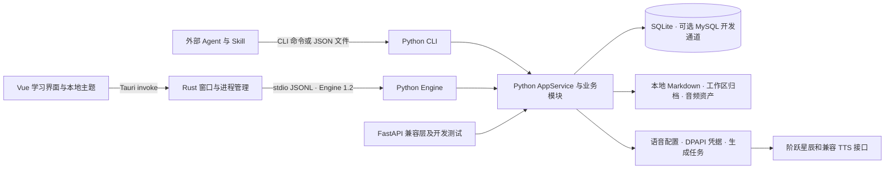
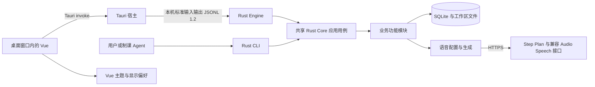

# StudyFlow 全 Rust 后端替换方案与工作流自审

2026-11-21 范围确认后的复核稿。工程基线为 Windows x64 的 1.8.27 源码和 MSI，包内 Skill 2.9.19。第 8 节区分用户已确认的产品边界和委托的工程判断，第 10 节给出本次复核结论。用户已确认本报告，后续执行与续接见[正式实施计划](../40_开发实施/2026-11-21-全Rust后端替换实施计划.md)。

## 1. 已决定的方向

桌面界面继续用 Vue、TypeScript、Tiptap 和既有主题，Tauri 负责原生窗口。课程、学习、批改、笔记、工作区、语音生成、CLI 与 Engine 的产品逻辑全部进入一套 Rust Core。开发可以按功能逐批完成，用户收到的第一个重构版本就使用完整 Rust 后端。现有安装版继续为学习者服务，至整套新版本通过安装演练。

长期收益是桌面原生部分与业务后端共用 Cargo、类型和错误处理，安装包与问题诊断可以退出冻结 Python 工具链。Vue 与桌面间仍有 IPC，外部 Agent 仍需要命令行协议。维护成本主要取决于这两处契约能否稳定，以及下一次修改能否在一个功能模块内完成。启动时间、体积与流畅度以将来发布候选的实测记录为准。选用 Rust 的决定已完成，无需性能竞赛或双后端过渡产品。

## 2. 现状与证据

### 2.1 端到端架构



| 部分 | 读到的实现 | 迁移相关事实 |
|---|---|---|
| Vue/TS | `app` 装配与路由，`features` 按功能，`shared/api` 已有类型和调用入口。常规及旧专项共用的 `CourseReader.vue` 有 763 行，承担生命周期、学习进度、侧栏、笔记与路由恢复。 | 课程体验与前端复杂度可独立改善。变更保存退出链前要覆盖已有行为。 |
| 主题 | `shared/themes` 已有契约、内置注册、导入校验、持久化、窗口同步和 token。课程和笔记仍有各主题对应的展示 CSS。 | 优化已有主题系统。用户主题及排版偏好无需迁到 Rust 或 SQLite。 |
| Tauri/Rust | `engine.rs` 管启动、读写管道、请求 ID、限时、子进程退出。`commands.rs` 在阻塞任务池调用 Engine，以单锁串行管理客户端。文件和窗口几何有独立模块。 | 进程边界有排障和失败隔离价值。排队等待和超时要分类型测；单锁争用可单独处理。 |
| Python Core | `modules` 已按 `courses`、`learning`、`planning`、`reviews`、`mistakes`、`documents`、`workspace`、`audio`、`speech_generation` 分域。本地 195 个 Python 文件约 11,846 物理行，含迁移和兼容入口；业务模块约 6,955 行。 | 有明确可复用的模块结构。学习与课程约占业务行数的三分之二，且共享事务、课程修订与冻结状态。 |
| 外部契约 | 1.8.27 的 `system.version` 返回 98 个能力名称。JSONL Engine 和 CLI `call` 的外层回执形状不同，CLI 还有命名命令和退出码。兼容 Web 用于开发与回归。 | 保留 CLI、能力发现和既有协议，通过适配器明确区分 JSONL 回执和 CLI 扁平回执。数字为发现列表长度，不代表 98 个独立业务模块。 |
| SQLite/文件 | SQLAlchemy 事务、Alembic 迁移与兼容字段检查并存。已到 `0018_plan_course_sequence`。存在只读打开、工作区租约、在线数据库备份、归档校验、文件写入与恢复。迁移输入含多个历史格式。 | Rust 可复用 SQLite 文件格式，仍要移植、验证数据库和文件事务语义。1.8.27 还含可选 MySQL 开发通道。用户已确认无人使用，重构版本仅支持 SQLite。 |
| 外部 TTS | `speech_generation` 已独立，`providers.py` 发网请求，服务管理配置 CAS、Windows DPAPI、任务锁、节点重试与采用；`audio` 负责 WAV/MP3、SHA-256 和资源读取。听力播放读取本地资产。 | 应把凭据、兼容映射、任务状态和音频读取分别归位。不能把 TTS 生成挪到播放时。 |
| 构建/CI | Python、Node、Cargo、PyInstaller 与 WiX 共同参与当前 Windows 构建。主要 PR CI 为 Ubuntu Python/Vue/浏览器。Windows Engine/Rust 检查仅手动触发，未包含 MSI 覆盖安装。 | Rust 交付需要可重复构建、隔离 smoke 和 Windows 安装升级关口。Linux CI 成功不能替代 Windows 路径、DPAPI 和 WebView2 验证。 |

源码审计参考 [Tauri 传输](../../apps/desktop/src-tauri/src/engine.rs)、[Tauri 命令](../../apps/desktop/src-tauri/src/commands.rs)、[Engine dispatch](../archive/python-runtime-20261121/INDEX.md) `packages/core/src/studyflow/interfaces/engine/dispatcher.py`、[CLI `call`](../archive/python-runtime-20261121/INDEX.md) `packages/core/src/studyflow/interfaces/cli/commands/api.py`、[前端 API](../../apps/desktop/src/shared/api/engine.ts)、[主题入口](../../apps/desktop/src/shared/themes/index.ts)、[SQLite 迁移](../archive/python-runtime-20261121/INDEX.md) `packages/core/src/studyflow/infrastructure/persistence/migrations.py`、[工作区归档](../archive/python-runtime-20261121/INDEX.md) `packages/core/src/studyflow/modules/workspace/repository.py`、[TTS 任务](../archive/python-runtime-20261121/INDEX.md) `packages/core/src/studyflow/modules/speech_generation/service.py`、[CI](../../.github/workflows/ci.yml)。

### 2.2 基线说明

前次盘点以 `00f01ff` 加未提交工作区增量为输入。1.8.27 MSI 为 37,244,928 字节，SHA-256 为 `8967E7FFD2CE3D8C11FF6578B5A398DC1678B28937B295C4B10FBF2521D90BB2`。当次解包记录为 CLI、Engine 和 45 个 Skill 文件匹配，Core 525 项通过、2 项跳过，前端英语 59、学习 132、主题 97 项通过。本机解包的旧程序曾采样 CLI 启动至退出 7 次，中位 1.47 秒，Engine 首次响应 4 次，中位 1.11 秒。以上是现有版本的历史证据。真实覆盖安装、人工听辨与 Rust 验收各需自己的记录。[1.8.27 实施与构建记录](../40_开发实施/2026-11-21-1.8.27听力当前句字幕.md)

## 3. 桌面调用方式和模块边界

**工程判断：保留 Tauri 托管的独立 Rust Engine，Rust Engine 和 Rust CLI 链接同一个业务库，桌面通过 Engine 使用它。** 现有宿主已经能区分“排队中未发出”和“写入可能已完成”，并能回收故障子进程。保留该边界可继续使用已建立的请求关联、超时回读和窗口响应机制。代价是每次桌面请求多一次本机管道传递，并须验证进程退出、版本匹配与迟到回执。这个代价由宿主和两个薄入口承担，与课程模块分离。



**三个接口有不同调用者。** Vue 在桌面窗口中用 `invoke('engine_call', …)` 调 Rust 命令。宿主通过已经存在的 Engine 1.2 JSONL 管道转发业务调用，窗口几何、置顶及生命周期由宿主处理。桌面学习和外部制课均可本机运行，无须手动打开系统浏览器、启动 Web 服务或 Docker。仅用户在语音模块发起试听或合成时，TTS 适配器才为该操作向供应商发送 HTTPS 请求。离线学习读取已采用的课程音频。现有词典发音的独立资源策略由 `audio` 管理。[桌面调用源码](../../apps/desktop/src/shared/api/engine.ts) · [宿主委派](../../apps/desktop/src-tauri/src/commands.rs) · [Tauri command 官方说明](https://v2.tauri.app/develop/calling-rust/)

**桌面测试承接旧开发桥的职责。** W0 为 `/api/engine`、`/health`、旧页面和表单逐条登记调用者与原来的断言。纯组件用例使用固定回执或模拟 `invoke`，命令与数据库行为通过真实 Rust CLI/Engine 验证，窗口、键盘、保存、播放及恢复在 Tauri/WebView2 里验证。原先经 `/health` 探活的流程改查宿主状态及 Engine 版本，依赖旧库的夹具改经 CLI 导入。Vite 的开发热更新可照常服务 Tauri 开发窗口。发行物只提供桌面与 CLI，测试无需新增一套长期维护的 Rust HTTP 服务。[旧开发桥](../archive/python-runtime-20261121/INDEX.md) `packages/core/src/studyflow/interfaces/web_compat/app.py` · [Vite 开发配置](../../apps/desktop/vite.config.ts)

### 3.1 目录、数据归属与接口

以下是拟建位置。一个 Cargo workspace 提供一个 Core 库，Core 内先用 Rust 模块分域。每个域把规则、私有数据访问和从其公开入口执行的测试放在一起。

```text
crates/studyflow-core/src/
  application/            跨模块用例、事务协调与跨域只读查询
  planning/  courses/     计划挂载与教材版本
  learning/  notebooks/   冻结轮次、作答、笔记及来源
  reviews/   mistakes/    批改、复测、错误证据
  documents/ audio/       文档渲染、词典与音频资产
  speech_generation/      配置、提供方适配、生成任务、采用
  workspace/              数据根、备份恢复及维护操作
  infrastructure/         SQLite 连接与迁移、文件、系统锁、凭据与诊断
crates/studyflow-runtime/ CLI、Engine 及共享命令登记与序列化
apps/desktop/src-tauri/   现有 Rust 宿主，管理窗口、Engine 与 IPC
apps/desktop/src/         现有 Vue 功能页、shared/api 和 shared/themes
skills/studyflow-agent/   原生 CLI 制课说明、示例与能力发现
```

| 功能模块 | 自己负责的数据和规则 | 供其他模块使用的能力 |
|---|---|---|
| `planning` / `courses` | 前者拥有计划、阶段、MAIN/SUPPLEMENT 挂载与排序。后者拥有课包 `/1`—`/8`、题序、修订、作者参考与质量规则。 | 按计划查询挂载、取得指定课程版本、验证和发布课包。学习模块以冻结版本号取得材料。 |
| `learning` / `notebooks` | 学习模块拥有轮次、答案、提交、客观题判分与进度；笔记模块拥有编辑版本、来源、可写权相关数据和保存回执。 | 保存/提交一轮作答、按期望版本保存笔记。桌面协调双窗交接，服务端用版本和原回执防止覆盖。作者预览复用同一客观题判分函数，返回范围按作者与学习者分别控制。 |
| `reviews` / `mistakes` | 前者拥有批改队列、作文反馈、修订及复测任务。后者拥有分域错误、来源和补充学习所需证据。 | 批改冻结提交、查询有界错误证据。新补充课的发布由应用用例协调课程与错题模块。 |
| `documents` / `audio` | 前者拥有 Markdown 渲染、链接和文档资源；后者拥有音频格式、摘要寻址、读取与词典资源解析。 | 渲染指定版本的材料，核验并读取音频。已采用成品可由多门课共享，课包引用保持 `{sha256, format}`。 |
| `speech_generation` | 拥有 profile、配置版本、任务、分段、字幕与采用流程。供应商映射归本模块，Windows 密钥保护使用基础设施。 | 桌面设置与 CLI 使用同一套读取/保存配置、试听、生成、查询、采用用例。`step_plan` 使用套餐专用 endpoint；`compatible` 接收用户填写的完整 endpoint。模型、音色、格式、鉴权、错误与 `instruction`/`instructions` 按协议处理。 |
| `workspace` | 拥有工作区选择、合法结构、备份清单、恢复与清理。 | 定位目标、独占维护、验证归档和切区；正常读写可跨桌面与 CLI 并存。 |
| `infrastructure` / `application` | 基础设施提供 SQLite 连接、事务机制、迁移、原子文件写入、锁、密钥保护和脱敏日志；应用用例拥有跨域提交或回滚的时机。 | 传入同一事务，按各域窄接口操作。查询跨表聚合有明确只读入口。单域规则和 SQL 在所属域修改。 |

**如何检查高内聚、低耦合。** 接口和错误由共享命令登记表派生 `capabilities`、`schema` 和 Vue 的协议校验依据。CLI 自己封装扁平回执与退出码，Engine 自己封装请求 ID 和 JSONL 外层。核心库可单独编译测试，依赖方向为“宿主/命令行入口 → 应用用例 → 业务模块及其所需基础能力”。窗口、命令行解析库和供应商报文留在边界。模块只公开必要类型，私有 SQL 与文件路径通过所属模块访问。仅把已有多个使用者、语义一致的文件操作、锁、诊断等提到公共工具，业务判分、配置版本规则和厂商字段有各自唯一归属。

三项变更可作为结构验收。① 调整听读填空归一化只改共享判分及其样例，作者预览和两种作答入口返回一致结果。② 接入另一个同协议语音地址只改 profile；新增一种确有差异的供应商映射，只改语音适配器及测试，播放器无需改动。③ 调整计划排序只改计划模块，桌面和 CLI 读取同一顺序。对整课提交，则由应用用例打开一次事务，按该用例写答案、提交、进度、相关事件和幂等回执；任一写入失败，所有变更一起撤回。远程 TTS 和大文件处理在事务外完成，验过摘要的文件就绪后才提交课程引用。[既有整课事务](../archive/python-runtime-20261121/INDEX.md) `packages/core/src/studyflow/modules/learning/course_answers.py` · [题组与作者预览](../archive/python-runtime-20261121/INDEX.md) `packages/core/src/studyflow/modules/learning/practice_groups.py` · [供应商适配](../archive/python-runtime-20261121/INDEX.md) `packages/core/src/studyflow/modules/speech_generation/providers.py`

前端继续按 `app/features/shared` 组织。主题注册、token、导入校验与跨窗偏好归 `shared/themes`，IPC 传输归 `shared/api`。课程路由、焦点、播放器、独立作文编辑器与保存退出归相应功能页。首次重构优先让现有组件接同一份后端契约。[主题入口](../../apps/desktop/src/shared/themes/index.ts)

技术基线建议为 Cargo workspace、`serde`/`serde_json`、`clap`、`rusqlite`（SQLite 与备份支持）及 `reqwest`。业务域共用工作区配置、事务机制和依赖锁；每个进程拥有自己的连接与运行时，跨进程一致性由 SQLite、工作区租约、版本号和幂等回执保证。依赖版本、许可证、Windows 链接和 TLS 行为随正式构建登记。[Cargo workspace](https://doc.rust-lang.org/cargo/reference/workspaces.html)

## 4. 接口和产品行为清单

实施时用一个清单逐行登记“现有入口、真实调用方、Rust 归属、成功和失败样例、证据及处置”。每个旧入口都应有测试或明确的退役决定。

| 面向谁 | 迁移和验收口径 |
|---|---|
| 桌面与外部脚本 | 从 `system.version` 的 98 个能力名起步，合并 `system.capabilities`、`system.schema`、CLI 命名命令树和特殊分支。冻结 JSONL 的 `id/ok/data/error`、CLI `call` 的扁平回执、UTF-8 BOM 文件输入、退出码、stdout/stderr、字段上限、可空与未知字段、协议 1.2。按方法区分只读、写入、带副作用的查询。`speech.job.get` 可能把失去执行者的任务标为中断，沿用登记的写入类别；能力发现与只读打开单独覆盖。旧 Skill 与新 CLI、新 Skill 与旧 CLI 都要能发现版本或提示缺少能力。 |
| 旧开发入口 | 旧页面、表单和 HTTP 桥按第 3 节将仍有价值的断言分别迁至组件、Rust 命令或真实桌面。退出标准为每条测试有新的验证位置，并在隔离环境中从已安装桌面成功运行相应流程。 |
| 工作区与 Agent | `system.installation` 从当前可执行位置发现 CLI、内置 Skill、协作区指针。验证中文与空格路径、用户配置的工作区、失效指针和只读发现空目录。区分仓库、安装包、已安装、独立公共 Skill 四个版本。同步公共副本应单列版本、备份与校验。 |
| 作者工具 | 现有 `authoring_quality.py` 转发 CLI，`authoring_workspace.py` 及其辅助模块用于授权资料根下的取词、选材与治理。建议把随包需要执行的能力收进 Rust CLI，Skill 给出新原生命令及旧脚本迁移说明。测试同样的输入输出、相对路径和边界，资料根与 AppData 业务根分离。仅仓库验证脚本可继续使用 Python。 [现有制课 Skill](../../skills/studyflow-agent/SKILL.md) |
| 课程与学习 | `/1` 至 `/8` 每版至少一份合成教材，覆盖合法及拒绝样例。常规理论课、`/6` 词句、存量 `/7`、`/8` 词句与听读写按作者题序混排、三个专项独立课均从「我的计划」实际进入。保留版本、读取顺序、冻结轮次、草稿、笔记、批改及复测来源。修订目标课按既有规则重置当前学习状态并保留应留笔记与历史，其余课程独立。 |
| 听读写与主题 | 单选点击选项后回车或「下一题」确认，末题显示「确认」。听读填空只编辑空位，`/8` 逐空以 NFKC、首尾去空白、Unicode casefold 后的完整英文匹配 accepted 列表，旧格式按其冻结规则。听力播放本地资产，进度旁可切「当前句」，检验暂停、拖动、重听、同题组切题、精确和估算时间轴。作文进独立编辑组件，保存草稿、提交、回看书面批改；普通英语题匹配与作文反馈各按自己的流程。三主题、理论课左右栏、独立笔记窗、退出保存失败、中文输入法与跨 DPI 纳入安装验收。 [播放器](../../apps/desktop/src/features/practice/ListeningPlayer.vue) · [作文组件](../../apps/desktop/src/features/writing/WritingWorkspace.vue) |
| TTS 配置和制课 CLI | 设置页查看和编辑 profile、模型、音色、格式。兼容模式可编辑完整请求地址，Step Plan 使用固定套餐地址，保存用配置版本，端点换址按原凭据绑定规则处理。Step Plan 与兼容供应商分别测试字段映射、401/429、超时和音频格式。保留当前 HTTPS／本机例外、禁重定向、响应上限与密钥脱敏，日志仅保留必要的错误码和诊断 ID。已有任务用原 `job_id` 查询，`speech.job.start → speech.job.get → speech.asset.adopt` 得到课程引用；同音频放入两门课，关闭制课进程、断网后从两课播放，统计练习期间供应商请求为零。多段 WAV 核对帧边界、音频摘要及字幕；旧音频直接回放。 [配置与任务](../archive/python-runtime-20261121/INDEX.md) `packages/core/src/studyflow/modules/speech_generation/service.py` · [现有供应商映射](../archive/python-runtime-20261121/INDEX.md) `packages/core/src/studyflow/modules/speech_generation/providers.py` |

## 5. 数据、升级与故障恢复

| 状态实际存在哪里 | 升级动作与通过条件 |
|---|---|
| SQLite 工作区 | 当前迁移 head 为 `0018_plan_course_sequence`。Rust 接受已支持的历史版和已识别的无版本旧库，迁移前一致性备份。只读发现应能报告缺库、残缺、未来版本且不创建或升级。新建库与升级库分别验证索引、约束、外键、版本行、课程序号和冻结题序、旧回执及冻结引用。首个 Rust 版本以兼容现格式为目标。[旧版本识别与迁移](../archive/python-runtime-20261121/INDEX.md) `packages/core/src/studyflow/infrastructure/persistence/migrations.py` |
| 归档 | 现有工作区导出覆盖 SQLite 一致性快照、纳入清单的 Markdown 与已采用的合法格式音频。恢复到新目录，验 manifest、大小、摘要和引用后才切换工作区。用一个备份还原出可继续同一轮次的合成课。[工作区归档实现](../archive/python-runtime-20261121/INDEX.md) `packages/core/src/studyflow/modules/workspace/repository.py` · [SQLite 在线备份](https://sqlite.org/backup.html) |
| `.studyflow/speech` | 当前已有配置、受保护凭据、任务元数据、分段和生成结果。原位升级保留上述状态，单测同一用户可读取旧 DPAPI 密文。跨用户或换机时提供重新配置入口，已采用的音频可继续播放。任务和未采用素材需要单独保全，普通课程归档只承诺上一行的覆盖范围。[凭据实现](../archive/python-runtime-20261121/INDEX.md) `packages/core/src/studyflow/modules/speech_generation/credentials.py` · [Microsoft DPAPI](https://learn.microsoft.com/en-us/windows/win32/api/dpapi/nf-dpapi-cryptprotectdata) |
| WebView 与安装设置 | 部分待确认草稿和主题偏好在 `localStorage`，工作区指针与窗口设置在宿主配置中。保留 app identifier、存储来源、键、窗口角色与配置定位。覆盖安装前留下未提交草稿、选定主题及独立窗位置，安装后同一用户打开验证。跨机可迁移范围按导出清单提示。 |

**并发与幂等。** 常规应用和 CLI 共用运行租约，维护操作获取独占租约，沿用锁名、路径归一化和 Windows 锁语义；语音还需工作区锁、生成锁和单任务锁。计划顺序、开始轮次归属、CAS 版本、原请求哈希、整课提交、题级事件、错误与笔记回执在同一用例事务内协调。用已有回执覆盖 Unicode、键排序、空格、数值和默认值，检查同键同参重放、异参拒绝及并发旧版本冲突。[运行与维护锁](../archive/python-runtime-20261121/INDEX.md) `packages/core/src/studyflow/infrastructure/leases.py` · [CLI 调用](../archive/python-runtime-20261121/INDEX.md) `packages/core/src/studyflow/interfaces/cli/commands/api.py`

**升级后有新记录时的撤回。** 先停止新写入，在隔离目录保全升级后的数据库、文档、音频及本机状态，再在副本验证旧程序能读取并继续这条新轮次。完全兼容才可切回旧程序；否则保留新数据并以前向修复版本恢复服务。升级前备份用于重演升级和恢复至当时的状态；涉及放弃后来数据的操作需用户另行选择。候选包和数据恢复分别演练。

**故障演练按可观察结果判定。** 以下场景记录原请求编号、工作区、错误码和状态回读，证据使用去标识的合成内容。

| 中断位置 | 应观察到的行为及责任方 |
|---|---|
| 排队超时、已提交丢回应、Engine 崩溃、回应晚到 | 桥区分 `ENGINE_BUSY`（尚未发出）和 `ENGINE_TIMEOUT` / `ENGINE_UNCONFIRMED`。释放不确定的旧连接，以请求 ID 匹配回执，保存方留住原工作区与幂等键并回读。注入“提交成功后进程终止”，相同请求重放后学习事件和批改队列各只增长一次，窗口可保留草稿或明确退出。 |
| 写入或生成中切工作区 | 宿主暂停接收新请求，检查在途保存与语音任务，有活动时返回忙并保留原指针。目标库通过校验后原子切换指针，后续请求绑定新工作区。旧窗迟到回执不得写进新库。[当前切换实现](../../apps/desktop/src-tauri/src/commands.rs) |
| 桌面未开，CLI 已退出；供应商收件后进程中断 | 建议 `start` 持久化原任务 ID、请求摘要、绑定版本和执行所需的合成输入，将任务交给随包 Engine 的工作模式。子进程确认接管并持有工作区及任务锁后返回启动回执，启动命令结束后可从新 CLI 轮询。工作模式从绑定 profile 取得凭据，命令行、任务输入文件和日志不含 API Key；受控任务文件按配置版本读取，版本变化时返回冲突。工作进程按任务启动、结束后退出。区分未发出、结果未知、分段已落盘、已可采用四种情形。同一 ID 先回读，可验证的已落盘分段直接复用；明确重试才补发缺段，告知该段存在重复计费可能。模拟服务记录每段实际请求次数。 |
| 版本号正确但缺表/列、锁被占用、迁移中断 | 先核实际结构，在维护独占期间取得并检查一致性备份，再迁移。用历史 revision、已提交 WAL、Windows `temp_store=MEMORY` 大批写、磁盘写满和只读目录演练。残缺或未来库、备份写失败均停止写入，并留下具体原因。 |
| 文件已落盘、课程尚未提交 | 新内容先在工作区暂存并验摘要，再发布版本文件并提交数据库引用；重启时核对遗留临时文件。读者只能打开完整版本，其他课复用的音频照常播放。归档需拒绝越界路径、超限和摘要不符。 |
| 维护 CLI 与只读预览 | 用夹具核验清理课程的 dry-run/备份确认、清理旧笔记的预览令牌、共享文档与音频引用的保护。租约或备份失败仅报告原因。另测未作答时的学习投影、作者预览和已确认后的解析可见范围。 |

## 6. 实施前供审核的工作流

各批使用合成课、合成旧库或工作区工具生成的合成归档。一次供应商验收使用合成台词，安装和撤回在隔离 Windows 环境实际演练。下表是依赖和完成判据，用户审定后才据此开正式实施任务。

| 批次与负责人范围 | 上游与交付 | 可验收结果 | 失败时停在哪里 |
|---|---|---|---|
| W0 契约与基线 | 承接用户对第 8 节的决定。记录 1.8.27 的 Git SHA、未提交和未跟踪文件指纹、MSI 哈希、接口清单、旧格式合成夹具及样课期望。固定安装包与含增量的可还原源码快照，排除私有数据和构建缓存。把现有测试按行为映射到新测试，为跳过项写明原因。核对已确认的 SQLite 与桌面边界，列出旧 MySQL 环境配置、开发代理、Web 页面及测试的处置。 | 新会话依靠清单可定位相同输入。接口清单逐项标归属，样例含成功与失败，遗留调用有去向。 | 未知入口或夹具无法复现时，先补对应项，再放行依赖它的批次。 |
| W1 后端基础与原生入口 | W0 → Cargo workspace、Rust Core、CLI/Engine、桌面 IPC 契约、工作区发现、只读打开、`0018` 及历史迁移、共享/独占锁、事务及回执、文件归档恢复。尽早接 Windows 构建与新源码发布白名单。 | 新库、旧库、坏库各走预期出口；SQLite 只读调用无数据库副作用；遗留非 SQLite 的 `STUDYFLOW_DATABASE_URL` 明确报错且不另建空库，诊断隐去连接串；旧格式归档可恢复；CLI 与 Engine 的外层回执各自正确。 | 使用合成副本，失败事务撤销；保留原目录、恢复点与诊断。 |
| W2 后端内容与计划 | W1 → planning、courses、documents、课程引用的音频读取与验证。覆盖挂载顺序、修订、预览、导入发布、质量检查、Markdown/YAML 和内容清理。 | `/1`—`/8` 合成教材从 CLI 发布、回读。验证排序、引用、活动课修订、标题锚点、表格、代码围栏、受控 HTML 与作者参考的可见时点。 | 文件写入或数据库发布失败均可重试，读者只看见完整的旧版或新版。 |
| W3 后端学习、笔记与批改 | W2 → 冻结轮次、草稿、普通/英语作答、笔记、整课事务、批改、错题与补充学习。 | 用同一工作区的 Engine 客户端和独立 CLI 交错保存、提交、批改与回读。验证双客户端编辑冲突、提交后丢回执、重开和冻结参考；W5 再用真实双窗验证单编辑权和退出保存。 | 前端保留未确认输入和原键，维护锁遇忙明确返回；失败事务里的进度、错题、提交不得部分生效。 |
| W4 语音与作者 CLI | W1 提供的文件和锁契约、W0 的接口样例即可启动；复用 W0 冻结的音频引用与文件格式，W2 后联调课程。完成 profile、凭据、生成、采用、原生制课工具和 Skill 指令。将 Step Plan 默认地址和提供方选项集中到 Rust 的提供方配置，Vue 从描述读取，CLI 共用同一配置。 | 模拟服务可数请求；验证已计费未回包、中途关闭、段级恢复、重复采用、两课共享资产及断网后可通过 Core 读取。W5 从播放器核对实际断网播放。真实供应商通过用户控制的配置做最小单次验收并记脱敏回执。 | 成品或已有分段保留；远端是否计费未知时提示核查，只有明确重试才再次发送。 |
| W5 前端与桌面集成 | W0 可先整理页面与契约用例。待 W1 适配器和各业务批到位，接 `shared/api`、语音设置、英文训练、独立写作、主题与原生窗。 | 从「我的计划」按题序走完第 4 节实际流程。从 release 构建目录启动真实 Tauri/WebView2，运行混排课、旧草稿和本地播放，持久化后 CLI 回读同一轮次。 | 验收缺一条就保留该流程未完成状态；允许其他无依赖模块继续。 |
| W6 Windows 候选与安装 | W1—W5 全部通过，集成方从发布构建中移除旧入口、Python/PyInstaller 依赖后，从干净目录产出 Rust MSI，核对 App/CLI/Engine/Skill、清单及 SHA，保留旧稳定安装包。 | 在干净 Windows x64 上用 en-US 标准 MSI 首装并验证依赖提示，从 1.8.27 及 W0 查明的实际使用版本分别覆盖升级，普通账户运行，路径含中文/空格；从旧快捷方式打开、从原路径运行 CLI、从设置页复制指令，在实际安装树分别回读 `system.installation`、`system.version`、`system.schema`。用已安装 WebView2 重跑 W5 的混排、草稿和播放，核对 CLI 与 Engine 实际映像路径、文件摘要、Skill 来源、工作区和预置进度。在升级后新答一题、写入新笔记，执行第 5 节的撤回演练并回读。记录安装条件、体积、启动、开课和保存耗时。 | 旧进程占用时安装可明确退出或安全重启；失败后验证原入口和数据仍能打开，发现混装即停止发布。 |
| W7 切换与交接 | W6 提供实际安装结果、一次带新进度的撤回演练及未覆盖的人验清单。形成数据兼容声明、构建记录与支持说明，确认 W6 候选已移除旧生产入口及构建依赖，逐项登记历史迁移、资源、测试和旧包去向。旧实现留在可恢复的历史快照。 | 安装包载荷、发布构建和运行进程只用 Rust 产品后端；桌面、命令行和制课均在无 Python/Node/Rust/Docker 的目标机运行。用户确认学习体验后再记录业务验收。 | 候选留在验证环境。需要时按第 5 节保全恢复，发布、真实工作区操作与公共同步按各自授权处理。 |

**安装与开发链分别核对实际进程。** 当前 `STUDYFLOW_ENGINE_PATH` 优先于随包 Engine，开发模式按 `packages/core/pyproject.toml` 发现仓库并可启动 Python。建议正式版默认使用本安装内通过版本与协议握手的 Rust Engine，开发覆盖走显式开发入口。W6 在遗留变量指向旧程序、旧快捷方式和文件占用条件下检查升级。W1 改用 Cargo workspace 发现开发根，W7 清点 CLI 帮助、Skill 示例与文档里的旧启动指令。[宿主程序发现](../../apps/desktop/src-tauri/src/workspace.rs)

部分浏览器与原生测试直接 `import studyflow`，如读取音频路径和计算笔记正文。W0 记录这些依赖，W2—W5 用 Rust CLI 创建合成夹具，分别用组件模拟回执、真实 Engine 和桌面窗口验证，保留固定预期，W6 在缺少旧 Core 的环境独立重跑。构建清单核对迁移 SQL、内置教材及模板、Skill、各原生二进制与 PyInstaller 残留。源码白名单只扩到指定 crate 和根 Cargo 清单。保留 `target`、私有数据、密钥的排除规则，记录工具版本、编译输入、签名状态、包摘要和启动进程。[现有测试导入](../archive/python-runtime-20261121/INDEX.md) `apps/desktop/scripts/smoke-english-practice.py` · [源码发布白名单](../../scripts/check_publish_boundary.py)

Windows 检查要进入重构期间的常规 CI。每次接口或共享代码变更跑 Rust 测试、序列化契约检查及 `npm --prefix apps/desktop run test:learning`、`test:english`、`test:themes` 和 `build`。发候选再跑安装矩阵、真实 WebView2 与完整离线制课资产回放。W6 按 D4 核对标准 MSI 在 WebView2 已存在与需下载两种条件下的行为；安装完成后单独验证已采用课程音频的断网播放。[现有 CI](../../.github/workflows/ci.yml) · [当前打包及 UpgradeCode](../../apps/desktop/src-tauri/tauri.conf.json) · [Tauri Windows 安装](https://v2.tauri.app/distribute/windows-installer/)

## 7. 给后续 AI 会话的交接约定

每批留一条可恢复记录，填写决定编号、批次、输入快照标识、所用接口与夹具版本、负责路径、交付物、实际命令及结果、尚未覆盖的场景和下一动作。集成负责人独占公共契约、迁移序列、Cargo 锁、版本号及安装清单。共享接口变更先更新受影响的样例和依赖方，同步提升契约修订号或摘要，标记受影响批次的旧结果需要重测，待同一修订合并后再联测。任务可并行的范围是 W2/W4 的分域代码及 W5 的前端用例，数据库迁移、公共音频契约和最终安装均串行集成。

若安装或发布被退回，写明最后通过的产物哈希、失败入口、可重试条件以及会受修复影响的批次。修复产生新二进制后重做受影响的用例、载荷校验和实际安装回读，证据绑定本次候选。

新会话先读 `AGENTS.md`、总控当前指针、阶段中控及本报告，再读所领批次交接。总控只登记一个下一动作。接口状态、自动化通过、真实安装和用户体验验收分别记录，避免下一个会话把“已设计”理解为“可直接发布”。

## 8. 已确认的产品边界与委托的工程判断

| 编号 | 复核后的处理 | 依据与影响 |
|---|---|---|
| D1 共用实现 | 使用一份 Rust Core，Engine 与 CLI 各有一个薄入口。Tauri 管理独立 Engine。 | 一份业务实现是用户要求。保留子进程是工程判断，沿用 1.8.27 的故障隔离、同工作区回读与协议 1.2。 |
| D2 数据库 | Rust 产品只支持 SQLite。 | 用户确认没有 MySQL 用户。退役驱动、相关运行配置和文档指引，保留原有 SQLite 工作区及已支持的合法 SQLite 配置。无需开发 MySQL 数据迁移工具。 |
| D3 桌面与 API | 唯一产品界面是 Rust + Vue 的 Tauri 桌面。沿用 `invoke` 和本机 Engine 管道，外部语音保留 Step Plan 与兼容模式。 | 桌面定位与外部 API 兼容是用户边界。本次选择将旧 Web 页和开发桥的断言迁至桌面及 Rust 命令，撤出 Web 产品与常驻 HTTP 服务的维护范围。 |
| D4 安装包 | 仅发行 `StudyFlow_<版本>_x64_en-US.msi`。沿用原 UpgradeCode、应用标识、安装入口、WebView2 引导方式，使用高于 1.8.27 的实际产品版本。 | 用户指定 1.8.27 MSI 为样板。只读查验该 MSI 的 ProductVersion 为 `1.8.27`、ProductLanguage 为 `1033`、UpgradeCode 为 `{ABFFC78E-4655-5CA9-B66B-386907AB5FEE}`，其 `DownloadAndInvokeBootstrapper` 安装动作条件为 `NOT(REMOVE OR INSTALLED_WEBVIEW2_VERSION)`。缺少 WebView2 时按现有方式联网下载；首版不另建离线包或其他平台安装包。 |
| D5 CLI 与 Skill | CLI、随包作者工具和语音任务由 Rust 实现。安装版 Skill 只调用原生命令。 | 用户已采纳。桌面可关闭，制课 Agent 独立完成生成、采用、发布与回读。仓库中的独立测试、夹具和文档审计可继续用 Python。 |
| D6 模块结构 | 按功能归属组织 Rust 模块，共享基础能力有独立位置，跨域写入由应用用例负责。 | 用户要求高内聚、低耦合。依赖方向、数据归属和三个可验证的改动例见第 3.1 节。 |

编号沿用上轮讨论。W0—W7 表示评估中的依赖与验收位置。范围已经确认，正式任务见开发实施阶段的计划，首次执行等用户更换模型后启动。

## 9. 成稿后的第二遍自审记录

2026-11-21 按 W0 → W7 先顺查上游交付，再从“用户覆盖后打开原来的课，外部 Agent 继续制课”反向查找证据。以下修订已写回对应批次。

| 审到的缺口 | 修订位置与结果 |
|---|---|
| W5 一度要求使用 W6 才产出的安装包；W4 又提前依赖 W2 尚在定义的格式 | 第 6 节改为 W0 固定音频契约，W4 可并行，W2 后联调。W3/W4 先用 CLI、Engine 证明数据行为，W5 用构建目录真实 WebView2，W6 用实际安装树重跑关键旅程并演练撤回。 |
| 安装器成功仍可能运行旧引擎；原生测试可能通过导入旧 Core 而假通过 | W0/W1 盘点覆盖变量、开发根发现和直接导入，W6 核对进程来源与哈希，在无旧 Core 的环境回读课程与版本。 |
| 普通备份覆盖不了语音任务及本机草稿；回退可能盖掉升级后答案 | 第 5 节列出四种存放位置，要求带新学习记录在副本演练。无法证明可无损降级时保全最新状态、采用前向修复。 |
| CLI 短命令退出与远端已收件是两个独立故障点 | 第 5 节明确任务由谁继续运行、失去回执用哪个 ID 找回以及何时允许补发。W4 要证明两课复用且学习端请求计数为零。 |
| 整课提交丢回执与切换工作区可能跨库重放 | 第 5 节增加已提交后中断和切区处理中断用例。W3/W5 分别核验数据库的单笔结果及窗口的草稿归属。 |
| 不同 AI 会话可在同一版本号上改出两套接口 | 第 7 节增加集成负责人、依赖失效条件与恢复记录。新会话以可还原快照、契约版本与实际证据续接。 |

**前次自审结论。** 已把依赖和失败出口写回方案。用户随后对产品边界作出选择，本轮范围见第 8 节，最终复核见第 10 节。

## 10. 用户确定范围后的复核结论

2026-11-21 依据当前源码与 1.8.27 MSI 再走查五条路径。前四条的验收动作供实施时执行，第五条含本次已取得的 MSI 只读证据。

| 走查路径 | 本次定位与修订 | 实施后应取得的证据 |
|---|---|---|
| 开课与提交 | 安装版中的 `isTauri()` 分支已经走 `invoke`。此前方案保留开发 HTTP 服务器的理由来自测试脚本。将这些断言映射到组件、Rust 命令、原生窗口后，产品可只维护桌面入口。 | 在已安装的 Tauri 中由「我的计划」进入旧课、混排英语课和独立写作。关掉开发服务仍可保存和提交；CLI 回读同一轮次。 |
| 一份实现、两个入口 | 同一组读写操作既有 CLI 命名命令、`call`，也有 Engine JSONL。旧 `speech.job.get` 还能将运行中断登记入任务。按实际副作用、错误码与回执封装分层，避免因方法名误分类。 | 构建同一版 Core 的两个入口，使用相同夹具与幂等键交叉调用；重放只产生一份结果，旧 Skill 可发现版本。界面和 CLI 对同一笔失败的下一步提示一致。 |
| 语音设置、CLI 制课与离线学习 | Step Plan 地址目前在 Vue 设置页与 Python 提供方各有一处。决定由 Rust 语音模块提供默认地址、字段约束和脱敏 profile；新地址通过兼容模式设置，播放器只读取已采用音频。 | 先在桌面保存两个配置，再从无桌面的 CLI 使用。模拟供应商核对两种请求字段、地址切换后的密钥绑定、响应丢失和显式重试。只合成一次成功音频，采用到两门课后断网播放，两课合计新增 TTS 请求为零。 |
| 数据退役、事务与恢复 | 旧配置支持 `STUDYFLOW_DATABASE_URL`。仅保留合法 SQLite 配置，错误的旧连接串应当显式失败，避免用户误入空工作区。SQL 写入、文件发布与远程生成由各自负责方协调。 | 无效配置不会创建数据库、日志不含凭据。两个客户进程交错提交，验证 CAS、回执、笔记与进度。升级后新增答案和笔记，再演练保留这些记录的恢复。 |
| 覆盖安装与工作交接 | 本轮以 Windows Installer 数据库只读模式核对 1.8.27 的包哈希、版本、语言、升级标识及 `DownloadAndInvokeBootstrapper`。确认采用标准 x64 en-US MSI，原包未执行。新会话从总控进入本报告，D1—D6 提供已定范围。 | 新版本经旧快捷方式启动，CLI、Engine、Skill 路径与候选匹配；旧冻结题序、笔记、主题和音频可以回读。记录缺 WebView2 时的安装行为、输入快照、产物哈希和实际运行版本。 |

[语音设置页](../../apps/desktop/src/features/speech-generation/SpeechGenerationSettings.vue) · [语音命令登记](../archive/python-runtime-20261121/INDEX.md) `packages/core/src/studyflow/interfaces/engine/speech.py` · [工作区配置](../archive/python-runtime-20261121/INDEX.md) `packages/core/src/studyflow/infrastructure/config.py` · [1.8.27 构建记录](../40_开发实施/2026-11-21-1.8.27听力当前句字幕.md)

**复核结论。** 范围已足够编排实施。工作量主要在历史 SQLite 状态与冻结轮次兼容、带副作用的命令、原生桌面回归和覆盖安装，技术选型可到此收口。后续按 W0 固定契约与输入，W1—W4 完成后端和 CLI，W5 联调前端，W6—W7 做实际安装、恢复与交付。文件归属、前置任务和验收方式已在正式实施计划编排。本轮完成方案、源码核对及 MSI 元数据核查，Rust 产品、升级和故障演练的结果由将来实施提供。

文档核对：复核稿内 39 处本地引用均可定位，D1—D6 和 W0—W7 各有唯一表项。公开边界扫描 767 个文件、0 问题。全仓文档审计在 7 份历史记录中发现 15 个失效链接，本轮涉及的文档无报错。
